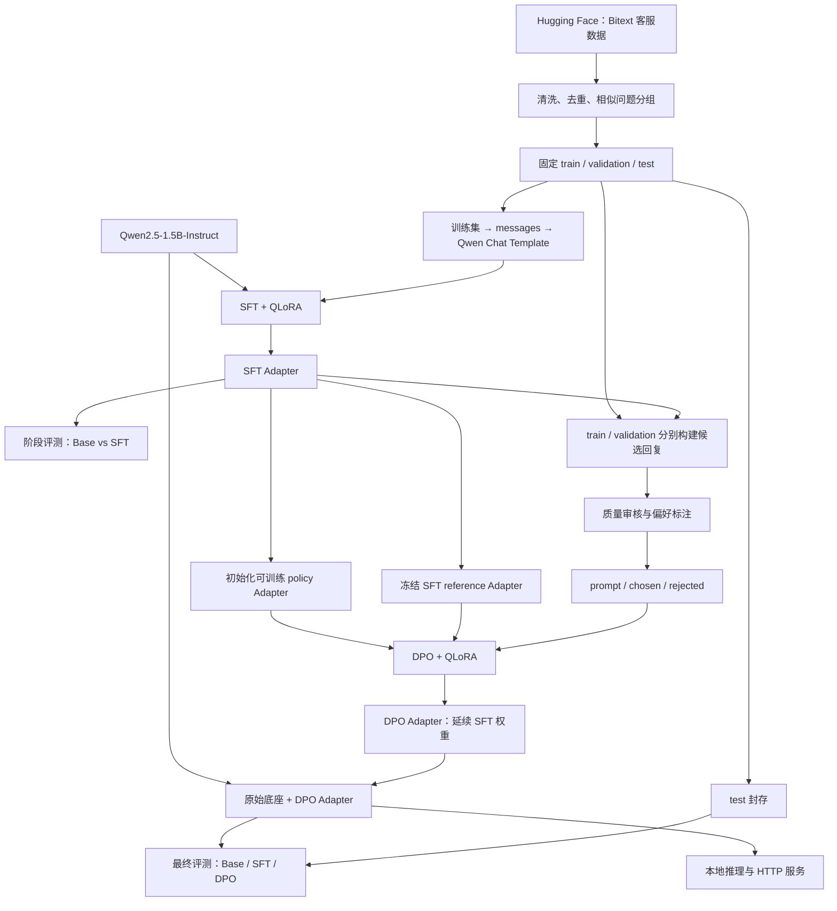

# Bitext 客服模型微调项目

基于 **Qwen2.5-1.5B-Instruct** 与 **Bitext 英文客服数据集**，规划完成数据准备、SFT + QLoRA、偏好数据构建、DPO + QLoRA、模型评测和推理服务。

> 当前状态：第一步的 4-bit 模型加载、单轮推理入口与运行记录代码已实现，尚未安装依赖、下载模型或执行验证。手动运行说明见第 10 节；数据处理、SFT、DPO、评测和服务仍为占位文件。下文训练参数及产物为后续规划，不代表已验证结果。

## 1. 项目目标

- 让模型学习客服问题的理解、问题澄清和可执行的处理建议。
- 比较原始 Instruct 模型、SFT 模型和 DPO 模型的回答质量。
- 用 QLoRA 降低训练资源需求，保存可独立加载到原始底座的 Adapter。
- 提供本地对话入口和 HTTP 推理服务。

第一版以英文单轮客服为主。中文客服、多轮业务流程、知识库检索和真实订单操作属于后续扩展；英文训练结果不能直接作为中文能力的证明。模型只生成建议，不实际取消订单、退款或查询账户。

## 2. 数据集与底座

| 项目 | 选择 |
| --- | --- |
| 数据集 | `bitext/Bitext-customer-support-llm-chatbot-training-dataset` |
| 底座 | `Qwen/Qwen2.5-1.5B-Instruct` |
| 数据语言 | 英文 |
| 上游规模 | 当前数据页面显示 26,872 条，11 个 category、27 个 intent |
| 原始字段 | `instruction`、`response`、`category`、`intent`、`flags` |
| 上游划分 | 一个 train split；项目自行划分训练、验证、测试集 |
| 数据许可证 | 数据卡标注 CDLA-Sharing-1.0 |
| 模型许可证 | 模型卡标注 Apache-2.0 |

数据品牌与 Hugging Face 命名空间的正确拼写是 **Bitext / bitext**。

来源：[Bitext 数据卡](https://huggingface.co/datasets/bitext/Bitext-customer-support-llm-chatbot-training-dataset)、[Qwen 模型卡](https://huggingface.co/Qwen/Qwen2.5-1.5B-Instruct)。下载时记录具体 revision、文件校验值、许可证和实际行数，避免上游变化影响复现。

**Bitext 提供的是指令与回复，不包含原生偏好标签。** DPO 所需的 `prompt / chosen / rejected` 必须另行构建和审核；不能直接把随机回复当作可靠的负例，也不能默认所有原始 response 都优于模型回答。

## 3. 整体流程



这里的 Base 是未经本项目训练的 **Qwen2.5-1.5B-Instruct**，不是 Qwen 的预训练 Base 版本。

## 4. 目录与职责

```text
.
├── README.md
├── .gitignore                         # 数据、模型、日志与本地环境忽略规则
├── .env.example                       # 待填写环境变量名称
├── requirements.txt                   # 第一步依赖范围，待用户验证后锁定
├── configs/
│   ├── data.yaml                      # 数据来源、清洗、划分
│   ├── sft.yaml                       # SFT、量化与 LoRA 参数
│   ├── preference.yaml                # 候选生成、审核与偏好筛选
│   ├── dpo.yaml                       # policy/reference 与 DPO 参数
│   ├── evaluation.yaml                # 评测集、指标、生成参数
│   └── inference.yaml                 # 模型路径、生成与服务参数
├── prompts/
│   ├── system.txt                     # 统一客服 system prompt
│   └── preference_judge.txt           # 偏好评审标准
├── scripts/                           # 后续命令行入口
│   ├── prepare_data.py
│   ├── train_sft.py
│   ├── build_preferences.py
│   ├── train_dpo.py
│   ├── evaluate.py
│   ├── chat.py
│   └── serve.py
├── src/
│   └── bitext_support/
│       ├── __init__.py
│       ├── data/
│       │   ├── __init__.py
│       │   ├── download.py
│       │   ├── clean.py
│       │   ├── split.py
│       │   ├── formatting.py
│       │   └── preference.py
│       ├── training/
│       │   ├── __init__.py
│       │   ├── model_loader.py
│       │   ├── sft.py
│       │   └── dpo.py
│       ├── evaluation/
│       │   ├── __init__.py
│       │   ├── generate.py
│       │   ├── metrics.py
│       │   └── compare.py
│       ├── inference/
│       │   ├── __init__.py
│       │   ├── predictor.py
│       │   ├── schemas.py
│       │   └── api.py
│       └── utils/
│           ├── __init__.py
│           ├── config.py
│           ├── seed.py
│           └── logging.py
├── data/
│   ├── raw/                           # 上游原始文件
│   ├── interim/                       # 清洗结果、分组映射与划分清单
│   ├── processed/
│   │   ├── sft/                       # 后续生成 train/validation/test.jsonl
│   │   └── preference/                # 后续生成 train/validation.jsonl
│   └── evaluation/                    # 独立人工用例与评分标准
├── outputs/
│   ├── sft/                           # SFT checkpoints 与最终 Adapter
│   ├── dpo/                           # DPO checkpoints 与最终 Adapter
│   ├── predictions/                   # 各阶段逐条回答
│   └── logs/                          # 训练与推理日志
├── reports/
│   ├── figures/
│   ├── data_quality.md
│   ├── sft_evaluation.md
│   └── final_evaluation.md
├── docs/
│   ├── data_contract.md
│   ├── preference_annotation.md
│   ├── experiment_log.md
│   └── serving.md
└── tests/
    ├── test_data_contract.py
    ├── test_split_leakage.py
    ├── test_chat_template.py
    ├── test_adapter_loading.py
    └── test_api.py
```

`src/bitext_support/` 是实际 Python 包路径。`scripts/` 负责参数解析和流程编排，`src/` 承载可复用实现。`configs/` 管理实验参数，`docs/` 记录规范，`reports/` 保存实验结论。

空产物目录使用 `.gitkeep` 保留。数据、模型权重、检查点、日志和密钥默认不提交；已填写用于本地环境与运行产物的 `.gitignore`。

## 5. 数据处理约定

### 5.1 清洗与去重

1. 检查字段、空文本、无效记录、编码及异常长度，记录每一步的样本数量。
2. 保留客服问题中的合理口语与拼写错误；`flags` 可用于分析这些语言现象，不是偏好标签。
3. 保留 `{{Order Number}}` 等业务占位符，不替换成编造的真实订单、网址或联系方式。
4. 对规范化后的问题与答案做精确去重；同一问题的冲突答案单独审核。
5. 依据规范化问题和近似表达生成 `group_id`，近重复问题尽量归入同组，降低模板改写导致的泄漏。

### 5.2 划分与数据隔离

初始规划比例为 **80% / 10% / 10%**，随机种子为 **42**。以问题组为划分单位，并尽量保持 intent 分布；比例允许因分组产生偏差，报告实际数量与类别覆盖。

- 同一 `group_id` 不得跨 train、validation、test。
- SFT 只使用 train 更新权重，validation 用于选 checkpoint。
- DPO 训练偏好来自 train；DPO 验证偏好来自 validation，继承已有划分，不能生成后重新随机混分。
- test 保持封存，不用于负例生成、偏好训练、提示词调整或超参数选择。SFT 阶段评测使用 validation，最终统一在 test 比较三个版本。
- 同时保留独立人工客服用例，补充合成数据无法覆盖的场景。

### 5.3 SFT 数据契约

每行一个 JSON 对象，使用 `messages` 对话格式；`sample_id`、`group_id`、`intent` 等作为溯源元数据，不直接拼进用户问题。

| 字段 | 约定 |
| --- | --- |
| messages | system、user、assistant 消息列表 |
| user.content | 原始 instruction |
| assistant.content | 审核后的 response |
| sample_id / group_id | 稳定样本编号与去重分组编号 |
| category / intent / flags | 分析与分层评测元数据 |

统一使用底座 tokenizer 的 Chat Template。SFT 计划仅对 assistant 回复计算损失，屏蔽 system、user 与 padding；具体模板是否支持对应掩码应在实现时验证。训练样本包含完整回答与结束标记；推理输入以生成提示结尾。模板只应用一次，避免重复特殊 token。

### 5.4 偏好数据契约

| 字段 | 约定 |
| --- | --- |
| prompt | system、user 消息列表，不含目标 assistant 回答 |
| chosen | 单条较优 assistant 消息列表 |
| rejected | 单条较差 assistant 消息列表 |
| sample_id / group_id | 继承源数据标识 |
| source / generator / rubric_version | 候选来源、生成模型与评分标准版本 |
| reason / review_status | 排序理由与审核状态 |

该项目选用对话式偏好格式；实现时应核对固定版本 TRL 的输入约定，训练前剥离辅助元数据。

构建流程：从固定划分取 prompt → 用 SFT 模型生成多个候选 → 将原始 response 作为候选之一 → 按统一标准比较 → 审核后保留有明确优劣的样本对。评分关注问题相关性、建议正确性、步骤可执行性、是否编造业务规则以及表达是否清晰礼貌。

允许用受控错误生成辅助负例，但不能仅依赖随机错配或明显无关答案。排除相同答案、排序不明确、截断后丢失差异和包含评审提示泄漏的样本；记录偏好来源占比并抽样人工复核。使用外部模型评审属于可选实现，不要求本阶段接入外部 API。

## 6. 两阶段训练设计

技术栈规划为 PyTorch、Transformers、Datasets、PEFT、TRL、Accelerate、bitsandbytes；推理服务规划使用 FastAPI 与 Uvicorn。此阶段不承诺依赖版本兼容性，后续完成最小训练与重载验证后再固定版本。

### 6.1 SFT + QLoRA

以 4-bit 方式加载并冻结原始底座，只训练 LoRA 参数；数据通过统一 Chat Template 转换。先用少量样本验证 loss、mask、保存与加载，再启动完整实验。

### 6.2 DPO + QLoRA

为实现最终“原始底座 + DPO Adapter”的加载方式，本项目约定：

1. 将 SFT Adapter 复制为可训练 policy，继续更新同一套 LoRA 参数，不重新初始化。
2. 保留独立、冻结的 SFT reference Adapter；reference 对应 **SFT 后模型**。
3. policy 与 reference 共享同一个冻结的量化底座，前向时选择对应 Adapter；优化器只更新 policy。
4. DPO 结束后单独导出 policy 为最终 DPO Adapter。它包含从 SFT 延续后的 LoRA 权重，推理时直接加载到原始底座，不再叠加 SFT Adapter。

不能将“关闭 Adapter 后的原始底座”误当成 SFT reference。实现时必须验证 policy 初始输出与 SFT 一致、reference 参数不变，并检查保存重载后输出一致性。若改用“合并 SFT 后新增 DPO Adapter”，其底座依赖就会改变，需要同步修改导出和部署约定。

DPO 的偏好格式与训练接口参考 [TRL DPO 文档](https://huggingface.co/docs/trl/dpo_trainer)；具体双 Adapter 调用方式需按最终锁定版本完成验证。

### 6.3 首轮实验参数草案

以下仅为待调优起点，不是性能或显存保证。

| 参数 | SFT | DPO |
| --- | --- | --- |
| 底座量化 | 4-bit NF4，double quantization | 同 SFT |
| 计算精度 | 硬件支持时 BF16，否则验证 FP16 | 同 SFT |
| LoRA rank / alpha / dropout | 16 / 32 / 0.05 | 继承 SFT 配置 |
| LoRA 目标模块 | q_proj、k_proj、v_proj、o_proj、gate_proj、up_proj、down_proj | 继承 SFT |
| 最大序列长度 | 1024 tokens，按长度统计调整 | 每个 prompt + completion 共 1024 tokens |
| 学习率 | 2e-4 | 5e-6 |
| epoch | 1–3 | 1 |
| 单设备 batch size | 1 | 1 个偏好对 |
| 梯度累积 | 16 | 16 |
| DPO beta | 不适用 | 0.1 |
| 随机种子 | 42 | 42 |

先在具备 NVIDIA GPU 的 Linux 或 WSL2 环境进行兼容性验证。实际显存需求取决于长度、batch、checkpointing 和 reference 实现；没有测量前不填写最低显存结论。

每次运行保存配置快照、模型与数据 revision、依赖版本、随机种子、硬件信息、数据统计和训练日志。Adapter 与 tokenizer、Chat Template、system prompt 版本关联保存；精确恢复训练还需保留优化器与调度器 checkpoint。

## 7. 评测方案

验证集用于开发和选择 checkpoint；固定测试集用于最终比较，三个版本共享同一批输入、system prompt、生成参数和评分标准。

| 维度 | 计划指标或方法 |
| --- | --- |
| 回答质量 | 人工或经人工校准的评审：相关性、正确性、可执行性、清晰度 |
| 偏好提升 | DPO 对 SFT 的盲评胜 / 平 / 负比例，随机交换答案顺序 |
| 业务可靠性 | 编造政策、虚构订单操作、错误承诺和不当索要信息的比例 |
| 覆盖情况 | 按 intent、category、语言现象分组报告并报告宏平均 |
| 自动辅助指标 | 验证 loss、偏好准确率及可选 ROUGE-L；不单独据此判断客服质量 |
| 运行成本 | 峰值显存、训练时长、吞吐、固定硬件上的推理延迟 |
| 回归检查 | 空输入、超长输入、业务范围外问题和多轮上下文 |

胜率报告须注明样本数、平局处理方法、评审方式和不确定性。测试回答中未填充的业务占位符也需单独统计。业务测试用例应附明确的模拟规则或政策上下文，避免评审凭空判断退款条件。

当前没有实验结果，以下内容后续再填：

| 模型 | 质量评分 | 对 SFT 胜 / 平 / 负 | 业务错误率 | 推理延迟 |
| --- | --- | --- | --- | --- |
| 原始 Instruct | 待评测 | 待评测 | 待评测 | 待评测 |
| SFT | 待评测 | 基准 | 待评测 | 待评测 |
| DPO | 待评测 | 待评测 | 待评测 | 待评测 |

## 8. 推理与服务约定

`predictor.py` 统一加载原始底座、指定 Adapter 与 tokenizer，供 CLI 和 API 复用；支持 Base、SFT、DPO 三种模式。第一版服务在启动时选择模型，不按请求反复加载权重。

| 计划接口 | 用途 |
| --- | --- |
| GET /health | 模型是否成功加载 |
| POST /chat | 接收 messages 与受限生成参数，返回 assistant 回答、模型标识和用量 |

服务应校验消息格式与长度，设置生成上限，清晰返回异常，避免在日志中完整保存用户敏感信息。服务只是语言模型问答演示，真实业务操作需要额外的业务系统接口与权限校验。

## 9. 后续实现顺序与验收

先完成第 10 节的环境与 4-bit 推理手动验证，再依次开展以下工作。

1. **数据准备**：实现下载、清洗、分组划分和数据契约校验；产出数据质量报告，检查跨集重叠。
2. **Base 基线**：在验证集保存原始模型回答，固定评测标准。
3. **SFT**：先小样本冒烟，再完整训练；完成 Adapter 重载验证与阶段报告。
4. **偏好构建**：实现候选生成、排序、人工抽检；保留可追溯的偏好训练和验证集。
5. **DPO**：核验 SFT 初始化与冻结 reference，训练并验证最终 Adapter 可直接加载到原始底座。
6. **最终评测**：冻结方案后对三模型执行同一测试，填写指标与失败案例。
7. **推理服务**：实现 CLI、API、输入校验和健康检查，补充部署文档。

`tests/` 当前只有预留文件。后续重点覆盖数据契约、划分泄漏、模板与损失掩码、Adapter 重载及 API 行为。

本阶段没有可执行的训练命令；待入口脚本、配置与依赖实现并验证后，再在本 README 补充安装、运行和部署步骤。

## 10. 第一步：本机环境与 4-bit 推理

本步骤已提供代码，**尚未运行验证**。以下命令由你自行执行。仅支持单张 NVIDIA CUDA GPU，不包含训练、Adapter、API 或自动化测试。

### 10.1 准备环境

建议使用 Python 3.11 的独立环境。在项目根目录执行：

```powershell
python -m venv .venv
.\.venv\Scripts\Activate.ps1
```

Linux / WSL2 使用 `source .venv/bin/activate` 激活。

先通过 [PyTorch 官方安装页](https://pytorch.org/get-started/locally/) 选择适合操作系统和驱动的 CUDA 版本，执行对应安装命令，再安装本阶段依赖：

```powershell
python -m pip install -r requirements.txt
```

requirements.txt 仅列出第一步使用的依赖范围，不是经过验证的锁定文件。PEFT、TRL 和数据处理依赖在后续阶段再添加。安装和 GPU 兼容性由你验证；成功后可自行记录完整版本：

```powershell
python -m pip freeze > requirements-local.txt
nvidia-smi
```

量化实现依据 [Transformers bitsandbytes 文档](https://huggingface.co/docs/transformers/quantization/bitsandbytes)，使用 NF4、double quantization；计算精度 auto 优先 BF16，不支持时选 FP16。平台兼容性参考 [bitsandbytes 安装说明](https://huggingface.co/docs/bitsandbytes/installation)。

### 10.2 准备模型

默认配置 `local_files_only: true`，只读取已下载的 Hugging Face 缓存或你指定的本地模型目录，不自动访问网络下载。请自行准备完整的原始 Instruct checkpoint 与 tokenizer 文件，不使用 GGUF 或其他预量化格式。

配置的模型 ID 为 `Qwen/Qwen2.5-1.5B-Instruct`。使用已有缓存时可直接运行；使用本地目录时传入 `--model`。远端来源的 revision 建议固定为实际 commit hash；本地目录来源由你记录。

### 10.3 手动运行

使用已有缓存：

```powershell
python scripts/chat.py --prompt "How can I cancel an order that has not shipped yet?"
```

使用自行下载的本地目录：

```powershell
python scripts/chat.py --model "D:/models/Qwen2.5-1.5B-Instruct" --prompt "How can I request a refund?"
```

仅当你希望脚本在运行时联网获取模型时，显式添加：

```powershell
python scripts/chat.py --allow-download
```

还可通过 `--config`、`--device`、`--revision` 覆盖配置。相对文件路径按项目根目录解析；GPU 编号是受 CUDA_VISIBLE_DEVICES 影响的逻辑编号。

脚本加载后检查 4-bit 标志与 Linear4bit 模块，使用 [模型 Chat Template](https://huggingface.co/docs/transformers/chat_templating) 生成一次回答。只解码新增 token；超长输入直接报错，不静默截断。默认贪心生成，采样参数可在 configs/inference.yaml 中调整。

### 10.4 运行记录与人工验收

成功后终端显示回答、GPU、计算精度和显存摘要，并在 `outputs/logs/step1-*.json` 写入环境、有效配置、模型信息、输入输出及耗时。每次运行生成新文件，不覆盖前一次结果。

你需要自行确认：

- 所选 GPU 正确，4-bit 加载成功，回答非空且可读。
- 退出后再次运行仍能加载并生成。
- 报告中的显存与耗时符合本机预期。
- 将驱动版本、本地模型来源与问题处理记录到 docs/experiment_log.md。

无 CUDA 时检查 CUDA 版 PyTorch 和驱动；缓存缺失时准备本地模型或自行显式允许下载；显存不足时先关闭其他占用 GPU 的程序，再减少输入/生成长度。程序不会静默改用 CPU 或全精度加载。

本阶段没有新增测试，也没有执行安装、下载、推理或验证。后续训练、数据处理及服务文件仍为占位文件。
